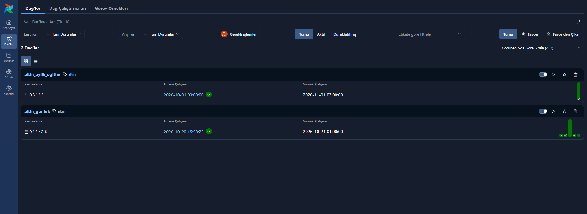
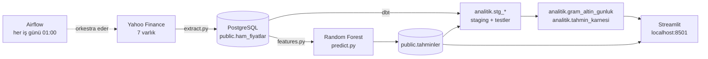
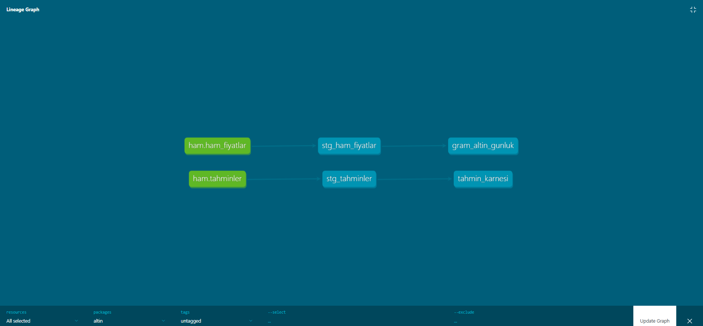
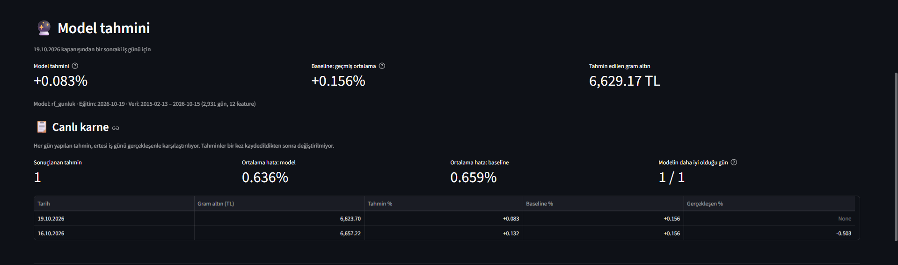

# Altın Pipeline

Gram altın (TL) fiyatı için **uçtan uca, kendi kendine çalışan bir veri pipeline'ı**: Her iş günü piyasa verisini çeker, PostgreSQL'e yükler, dbt ile dönüştürüp test eder, ertesi günün tahminini üretir ve modelin canlı performansını kaydeder. Hepsi Docker Compose ile tek komutla ayağa kalkar ve Airflow ile zamanlanır.

> **Kısa bulgu:** Günlük gram altın hareketini tahmin etmek, basit kurallardan anlamlı şekilde daha iyi yapılamıyor. 1.959 günlük walk-forward testinde en iyi model "geçmiş ortalama" baseline'ıyla aynı hatayı verdi (MAE %1,017'ye karşı %1,013). Projenin odağı bu yüzden tahminin kendisi değil; **güvenilir veri altyapısı ve dürüst model değerlendirmesi**.



---

## Mimari



| Bileşen | Görevi |
|---|---|
| **Airflow 3** | Her iş günü 01:00'de `veri_cek → dbt_build → kalite_kontrol → tahmin`, her ayın 1'inde modeli yeniden eğitir. 2 retry, `catchup=False`, `max_active_runs=1` |
| **PostgreSQL 16** | Ham veri (`public`) ve dbt çıktıları (`analitik`) ayrı şemalarda. Airflow'un metadata'sı aynı sunucuda ayrı veritabanında |
| **dbt 1.12** | Staging ve mart modelleri, 13 veri testi (hazır testler + kendi yazdığım `pozitif` testi) |
| **Python** | Veri çekme (yfinance), upsert ile yükleme, feature üretimi, scikit-learn / XGBoost |
| **Streamlit** | Güncel fiyat, günün tahmini, canlı karne ve walk-forward grafiği |
| **Docker Compose** | 4 servis: `db`, `app`, `airflow`, `dbt` |

### dbt soy ağacı



---

## Model değerlendirmesi

**Yöntem:** Walk-forward (genişleyen pencere). 2019–2026 arasındaki her test yılı için model sadece o yıldan önceki veriyle eğitildi ve o yılın günleri üzerinde test edildi. Eğitimin son günleri atıldı, çünkü onların hedefi test yılına taşıyor (sızıntıyı önlemek için purge). Toplam 1.959 test günü. Her model üç basit kuralla karşılaştırıldı.

**Hedef:** Gram altının ertesi iş günündeki yüzde değişimi.

| Yöntem | MAE (yüzde puan) | Yön isabeti |
|---|---|---|
| Baseline: "hiç değişmez" (0) | 1,024 | – |
| Baseline: "geçmiş ortalama kadar değişir" | **1,013** | – |
| Baseline: "her gün yükselir" | – | **%56,3** |
| Random Forest, fiyat seviyeleri (ilk sürüm) | 1,134 | %49,0 |
| XGBoost, fiyat seviyeleri | 1,866 | %47,4 |
| **Random Forest, durağan feature'lar (canlıdaki model)** | **1,017** | **%55,8** |
| XGBoost, durağan feature'lar | 1,042 | %55,8 |

*Değerler test günü sayısına göre ağırlıklı ortalamadır.*

**Ne öğrendim:**

1. **İlk model yeni fiyat seviyelerinde çöküyordu.** Fiyat *seviyeleriyle* eğitilen ağaç modelleri, eğitimde hiç görmedikleri fiyat seviyelerinde (TL'nin değer kaybıyla sürekli yeni zirveler) tahmin üretemiyordu, çünkü ağaçlar ekstrapolasyon yapamaz. Yön isabeti yazı-turanın altındaydı (%49).
2. **Durağan feature'lar sorunu çözdü.** Getiriler, hareketli ortalamadan sapmalar ve yüzde volatilite kullanınca hata %1,134'ten %1,017'ye indi.
3. **Ama model baseline'ları geçemiyor.** "Geçmiş ortalama" kuralı kadar iyi, "her gün yükselir" kuralından biraz kötü. Haftalık ufukta görülen "başarı" ise büyük ölçüde TL'nin sürekli değer kaybından (drift) geliyordu.
4. **Ek göstergeler de yardımcı olmadı.** VIX (küresel korku endeksi), ABD 10 yıllık faizi ve BIST 100 ile
   ayrı ayrı ve birlikte deney yaptım. Kabul kuralını sonuçlara bakmadan önce belirledim (mevcut modelden ve
   baseline'dan düşük hata, en az 5/8 yılda baseline'ı geçme). Hiçbir grup kuralı geçemedi: MAE 1,016–1,021,
   baseline 1,013. BIST 100 eklemek modeli biraz kötüleştirdi.
   
Bu sonuç piyasaların günlük hareketleri büyük ölçüde fiyatlamasıyla tutarlı. Bu yüzden modelin performansını **canlı** olarak da izliyorum: Her gün yapılan tahmin, bir kez kaydedildikten sonra değiştirilmiyor ve ertesi gün gerçekleşenle karşılaştırılıyor (`analitik.tahmin_karnesi`). Canlı karne Ekim 2026'da başladı.



---

## Veri kalitesi ve güvenilirlik

- **İdempotent yükleme:** `(tarih, sembol)` birincil anahtarı ve `ON CONFLICT DO UPDATE`. Pipeline her çalışmada son 10 günü yeniden çeker, böylece kaynaktaki düzeltmeler de yakalanır ve aynı veri iki kez yazılmaz.
- **Tahminler değiştirilemez:** `tahminler` tablosu `DO NOTHING` ile yazılıyor. Geçmiş tahmin sonradan "düzeltilemez".
- **Katmanlı kontroller:**
  - `extract.py` boş veri gelirse hata fırlatır (sessizce eksik yüklemez)
  - dbt testleri: tekrar eden satır, boş değer, beklenmeyen sembol, negatif fiyat
  - `quality.py`: Veri bayatsa çıkış kodu 1 verir ve tahmin adımı çalışmaz
- **Saat dilimi:** Container'lar UTC'de çalışıyor. "Bugün" hem Python'da hem SQL'de Türkiye saatine göre hesaplanıyor (gece 01:00 TR = 22:00 UTC, önceki gün).
- **Bağımlılık izolasyonu:** Airflow, proje kodu ve dbt aynı container'da üç ayrı sanal ortamda çalışıyor. Airflow'un pandas/NumPy/scikit-learn sürümleri modelinkilerle çakıştığı için Airflow sadece orkestra ediyor.

---

## Kurulum

Gereken tek şey **Docker Desktop**.

```bash
git clone https://github.com/ikuzunlu/altin-pipeline.git
cd altin-pipeline
cp .env.example .env                 # POSTGRES_PASSWORD'ü değiştir

docker compose up -d db
docker exec altin-db psql -U postgres -c "CREATE DATABASE airflow;"

docker compose build
docker compose run --rm app python src/pipeline.py    # İlk çalıştırma 2015'ten bugüne tüm geçmişi çeker
docker compose run --rm app python src/evaluate.py    # Walk-forward değerlendirmesi (grafik için)
docker compose run --rm app python src/train.py       # Modeli eğit
docker compose run --rm dbt build                     # dbt modelleri + testler

docker compose up -d
```

| Adres | Ne |
|---|---|
| http://localhost:8501 | Streamlit uygulaması |
| http://localhost:8080 | Airflow paneli (DAG'ları açma/kapama düğmesiyle aktifleştir) |
| `localhost:5433` | PostgreSQL |

dbt dokümantasyonu ve soy ağacı:
```bash
docker compose run --rm dbt docs generate
docker compose run --rm --service-ports dbt docs serve --port 8081 --host 0.0.0.0
```

> Airflow paneli yerel kullanım için şifresiz yapılandırıldı (`SIMPLE_AUTH_MANAGER_ALL_ADMINS`). İnternete açık bir sunucuda kullanılmamalı.

---

## Proje yapısı

```
altin-pipeline/
├── app/app.py                 # Streamlit arayüzü
├── dags/altin_dags.py         # Airflow: günlük pipeline + aylık eğitim
├── dbt/
│   ├── models/staging/        # Kaynak tanımları, temizlik, testler
│   ├── models/marts/          # gram_altin_gunluk, tahmin_karnesi
│   └── tests/generic/         # Kendi testim: pozitif
├── src/
│   ├── extract.py             # Yahoo Finance'ten veri çekme
│   ├── load.py                # PostgreSQL'e upsert
│   ├── pipeline.py            # Artımlı yükleme (son 10 gün)
│   ├── quality.py             # Veri kalitesi kontrolleri
│   ├── features.py            # Durağan feature'lar
│   ├── evaluate.py            # Walk-forward + baseline'lar
│   ├── train.py               # Model eğitimi
│   └── predict.py             # Günlük tahmin + canlı karne
├── Dockerfile                 # Streamlit image'ı
├── Dockerfile.airflow         # Airflow + proje ve dbt için ayrı venv'ler
└── docker-compose.yml
```

---

## Teknolojiler

Python 3.12 · PostgreSQL 16 · Apache Airflow 3.3 · dbt-core 1.12 · Docker Compose · pandas · SQLAlchemy · scikit-learn · XGBoost · Streamlit · yfinance

## Sonraki adımlar

- Canlı karne birkaç ay biriktikten sonra sonuçları bu README'ye eklemek
- Hata durumunda bildirim (e-posta / Telegram)
- Kalite eşiklerini varlık bazında ayarlamak
- Model dosyalarına sürüm ekleyip yeniden eğitimleri karnede ayrı izlemek
